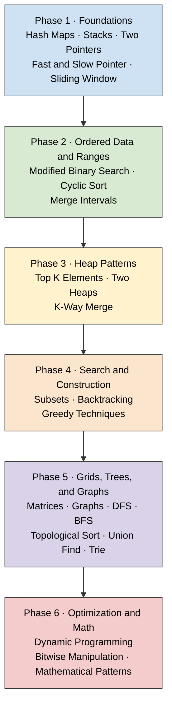
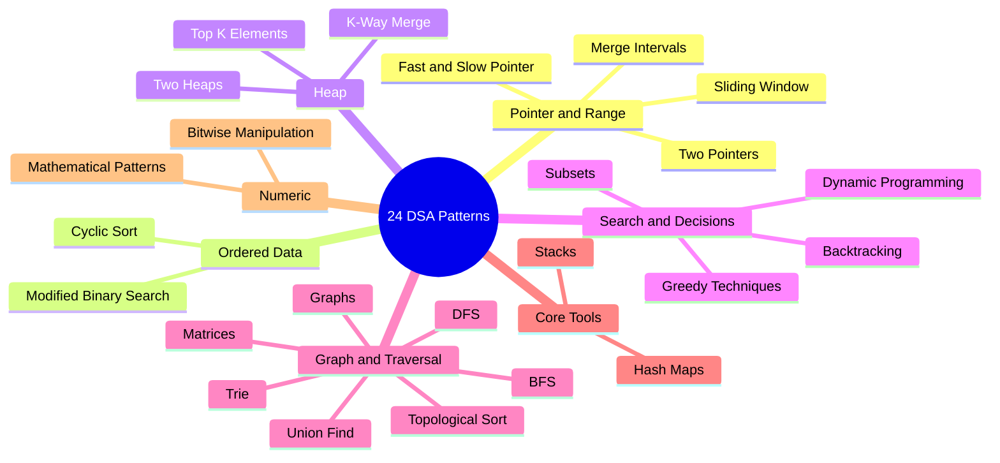
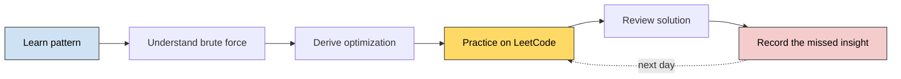

# 🧭 Every-Day DSA Roadmap

> **For:** An experienced engineer with 10+ years of coding experience and no conventional DSA practice.
> **Practice platform:** LeetCode
> **Method:** Learn one pattern at a time and practice every day.
> **Current scope:** The 24 target patterns below. Individual problems will be added later.

---

## 🎯 The Goal

Build this interview reflex:

---

## ✅ Target Set: 24 DSA Patterns

This is the target curriculum, divided into a dependency-based learning order. Closely related items remain separate because each requires a different problem-solving reflex.

### Phase 1 — Foundations

Build fast lookup, state tracking, and controlled pointer movement.

1. [ ] Hash Maps
2. [ ] Stacks
3. [ ] **Two Pointers**
   - [x] [LeetCode 167 — Two Sum II: Input Array Is Sorted](dsa/problems/two-pointers/0167-two-sum-ii.md) · Medium · Python
4. [ ] Fast and Slow Pointer
5. [ ] Sliding Window

### Phase 2 — Ordered Data and Ranges

Learn to exploit ordering instead of scanning every possibility.

6. [ ] Modified Binary Search
7. [ ] Cyclic Sort
8. [ ] Merge Intervals

### Phase 3 — Heap Patterns

Learn to maintain the most important elements without fully sorting the input.

9. [ ] Top K Elements
10. [ ] Two Heaps
11. [ ] K-Way Merge

### Phase 4 — Search and Construction

Learn to explore choices, undo decisions, and make locally optimal decisions.

12. [ ] Subsets
13. [ ] Backtracking
14. [ ] Greedy Techniques

### Phase 5 — Grids, Trees, and Graphs

Learn representation, traversal, connectivity, and dependency ordering.

15. [ ] Matrices
16. [ ] Graphs
17. [ ] DFS (Depth-First Search)
18. [ ] BFS (Breadth-First Search)
19. [ ] Topological Sort
20. [ ] Union Find (Disjoint Set Union / DSU)
21. [ ] Trie

### Phase 6 — Optimization and Math

Finish with state optimization and specialized numeric techniques.

22. [ ] Dynamic Programming
23. [ ] Bitwise Manipulation
24. [ ] Mathematical Patterns (GCD, Sieve of Eratosthenes, Fast Exponentiation)

> This is a valid interview-preparation set. It mixes data structures, broad topics, traversal methods, and specific techniques, but together they provide strong coverage of common DSA interviews.

---

## 🗺 Recommended Learning Path

The target set remains the same 24 patterns, but this order builds each skill on top of earlier ones.

### Why this order?

- **Hash Maps and Stacks** establish fast lookup and state tracking.
- **Pointer patterns** teach how to avoid unnecessary nested loops.
- **Binary Search, Cyclic Sort, and Merge Intervals** build reasoning about ordered data.
- **Heap patterns** share priority-queue mechanics and should be learned together.
- **Subsets and Backtracking** establish recursion and decision-tree thinking.
- **DFS and BFS** reuse those traversal ideas in matrices and graphs.
- **Topological Sort and Union Find** build on basic graph understanding.
- **Dynamic Programming** comes late because it benefits from recursion, state modeling, and traversal experience.

---

## 🧠 Pattern Family Map

> Families overlap. For example, Sliding Window commonly uses a Hash Map, and Topological Sort commonly uses BFS or DFS. Label a problem by its **primary strategy** and separately note the supporting data structure.

---

## 🔍 Quick Recognition Guide

| Problem clue | First pattern to consider |
|---|---|
| Pair or triplet in an array; compare from both ends | Two Pointers |
| Cycle or middle of a linked structure | Fast and Slow Pointer |
| Longest, shortest, or valid contiguous sequence | Sliding Window |
| Overlapping time or numeric ranges | Merge Intervals |
| Continuously track lower and upper halves | Two Heaps |
| Merge several sorted sources | K-Way Merge |
| Find largest, smallest, or most frequent `K` items | Top K Elements |
| Sorted or rotated data; search a monotonic answer space | Modified Binary Search |
| Generate every selection | Subsets |
| Make the locally best safe choice | Greedy Techniques |
| Explore choices and undo them | Backtracking |
| Repeated subproblems with reusable state | Dynamic Programming |
| Values lie in a known range, often `1..n` | Cyclic Sort |
| Dependencies or prerequisite ordering | Topological Sort |
| Grid movement, regions, or neighboring cells | Matrices |
| Matching symbols or nearest greater/smaller item | Stacks |
| Nodes connected by edges | Graphs |
| Explore deeply before trying alternatives | DFS |
| Explore level by level or find an unweighted shortest path | BFS |
| Prefix lookup or dictionary search | Trie |
| Fast lookup, counting, grouping, or deduplication | Hash Maps |
| Connectivity between changing groups | Union Find |
| Flags, masks, XOR, or powers of two | Bitwise Manipulation |
| Primes, divisibility, large powers, or number theory | Mathematical Patterns |

---

## 📅 Every-Day DSA Routine

### Daily session

1. Spend **5–10 minutes** recalling the current pattern without notes.
2. Spend **25–30 minutes** attempting one LeetCode problem.
3. If blocked, study the editorial instead of guessing indefinitely.
4. Close the solution and implement it again from memory.
5. State the **time and space complexity** aloud.
6. Record the clue you missed, not just the final code.

### Weekly rhythm

| Day | Focus |
|---|---|
| Monday–Friday | Learn and practice the current pattern |
| Saturday | Retry missed problems without looking at solutions |
| Sunday | Light review, rest, or a timed mock |

### When is a pattern learned?

Move forward when you can:

- [ ] Explain when the pattern applies.
- [ ] Describe its brute-force alternative.
- [ ] Write its basic template without copying.
- [ ] Solve at least one unseen problem using it.
- [ ] Explain its time and space complexity.

You do not need permanent mastery before moving on. Revisit older patterns through weekly review.

---

## 📒 Miss Log

| Date | Problem | Pattern | Clue I missed | Insight to remember | Retry date |
|---|---|---|---|---|---|
| | | | | | |
| | | | | | |

---

> **Current boundary:** Learn and track only these 24 patterns. Do not expand the curriculum until this set has been practiced.
